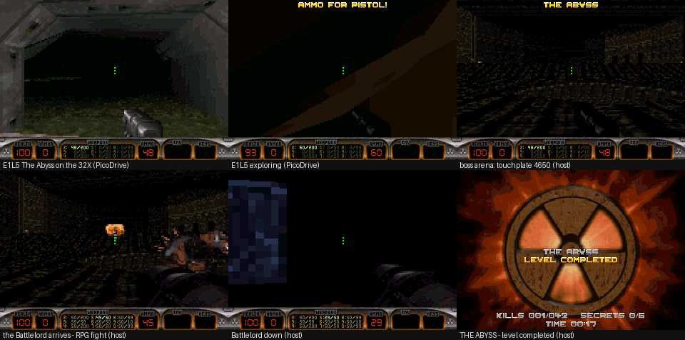
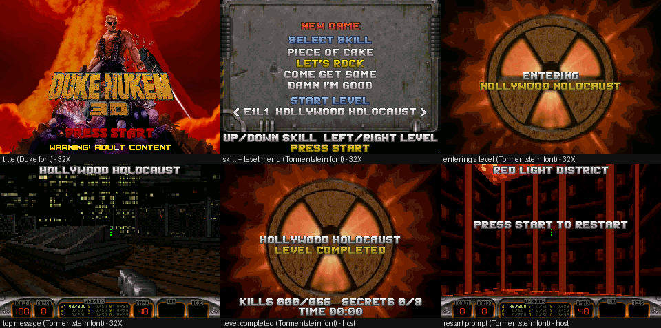
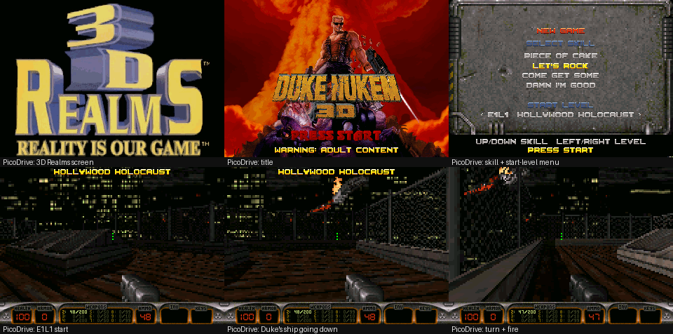
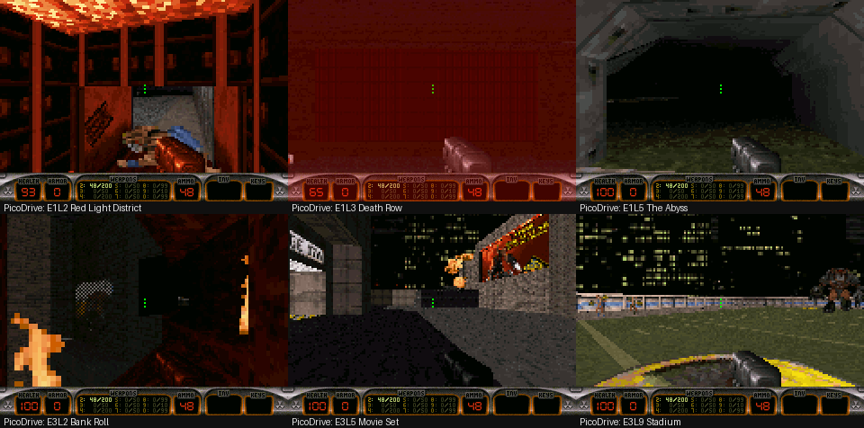
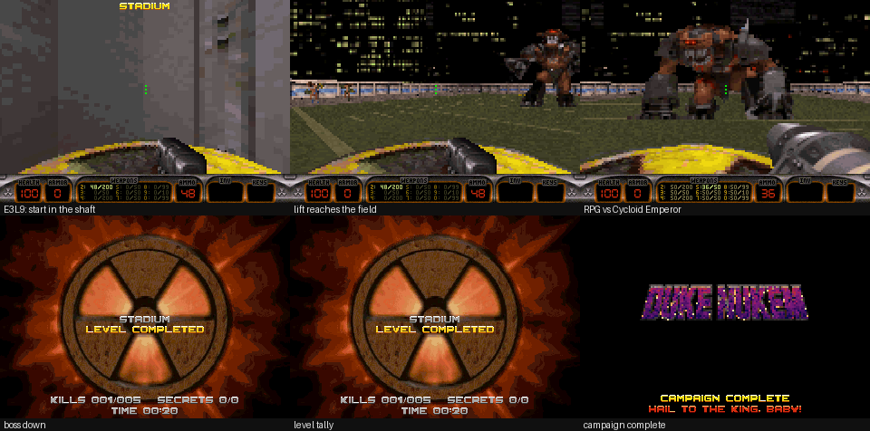
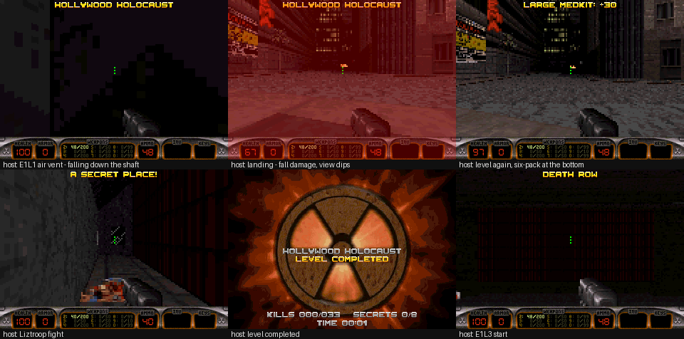

# Duke Nukem 3D — Sega 32X port (reduced, 4 MB ROM)

| | |
|---|---|
| ROM | `rom/duke3d32x.32x`: 4,194,304 bytes, `SEGA 32X` header ("DUKE NUKEM 3D 32X"), checksum fixed (about 4,068 KiB used) |
| Target | Sega 32X + Mega Drive/Genesis: 2× SH-2 at 23 MHz, 256 KB SDRAM, PWM audio, 68000 for the pads |
| Data | Your registered **`DUKE3D.GRP`** (Plutonium Pak v1.4: 44,348,015 bytes, CRC32 `F514A6AC`), converted by `tools/convert.py`. **Eight campaign levels are in the ROM**, including E1L4 Toxic Dump and E1L5 The Abyss. |
| Tests | `make check`: static ROM checks plus 6 headless PicoDrive tests, all passing. Test 06 boots every later level on the 32X build. |









## Building

```sh
./setup.sh        # once per sandbox start: 32XDK (GCC 12.1, sh-elf + m68k-elf) + PicoDrive core
make assets       # assets/ + DUKE3D.GRP -> gen/: both fonts, the full-screen pictures, the game data blob
make              # -> rom/duke3d32x.32x (fails if SDRAM use collides with the stacks)
make check        # verify_rom.py + tests/run_tests.py (PicoDrive: boot, menu, gameplay, audio, fps, levels)
make hostgame     # desktop runner of the same game code (scripted pad, PPM frames)
```

`make data` still converts just the GRP side (it also re-reads the two pictures).

### Assets

| File | Converted by | Used for |
|---|---|---|
| `assets/realms.png` | `tools/convert.py` → the data blob (LZ4) | the 3D Realms screen at power-on |
| `assets/title.png` | `tools/convert.py` → the data blob (raw 320×224 pixels) | the title background, without text |
| `assets/title_logo.png` | `tools/convert.py` → two sprites sharing the title's palette | the DUKE NUKEM / 3D logo that slams onto the title; 3D is shifted left to make room for 32X. |
| `assets/title_32x.png` | `tools/convert.py` → a sprite sharing the title palette | the 32X artwork, zoomed in after 3D with its own explosion sound. |
| `assets/transition.png` | `tools/convert.py` → the data blob (LZ4) | the level transition screens: ENTERING *level* and LEVEL COMPLETED. It replaces Duke's `LOADSCREEN` tile, which is dropped. |
| `assets/dukefont.png` | `tools/mkbigfont.py --prefix dfont` → `gen/dukefont.h` | Duke's big red font, **only** on the title and pause screens. Its 13 colours are also added to the title palette. |
| `assets/tormentfont.png` | `tools/mkbigfont.py --prefix tfont` → `gen/tormentfont.h` | the Tormentstein 3D font: the **top messages** (and the restart prompt), the **ENTERING / LEVEL COMPLETED** screens, and the **skill and level menu**. Its colours, in the white and gold tints used there, are added to the transition picture's palette. |
| `assets/font.png` | `tools/mkfont.py` → `gen/font8x8.h` | what's left: the title's adult-content warning and the campaign-complete screen |

Replace a PNG and run `make assets && make`.
* The pictures can have any palette. Each screen keeps its own and is quantised only if it runs out of its 255 entries (index 255 is the logo's see-through colour):
  * the title shares its palette with the logo, the big font (13 colours) and the text styles (14), and still fits exactly at 251 colours;
  * the transition picture adds the 14 text-style colours;
  * the 3D Realms screen uses only its own colours.
* The static screens are stored as LZ4.
  * They're decoded in RAM, in the level's wall array, which is idle between levels.
  * Decoding straight into the 32X framebuffer would read it back, and that isn't reliable.
* `dukefont.png` and `tormentfont.png` must keep their layout: a sample line, then the rows `!"#$%&'()*+,-./`, `0-9`, `A-M` and `N-Z`. The rows may touch (Duke's sheet) or have gaps (Tormentstein's).
  * Glyphs that touch are cut apart by colour.
  * The game prints a few characters the sheets lack, so the tool builds them: `:` and `;` from the full stop and comma, `<` and `>` from halves of the slash.
  * Text can be drawn tinted: white, gold, red or blue. Tinting keeps the font's own shading and is matched to the palette on screen. The menu uses red for the header, blue for labels, white for options and gold for the selection.
  * Its glyphs touch each other, so the tool cuts them apart by colour rather than by empty columns.
  * Its letters and digits come out exactly as Duke's own `BIGALPHANUM` tiles.

`tools/find_grp.py` picks the GRP automatically. It looks for a registered/Atomic GRP (one containing `E3L2.MAP`) anywhere under `/home/user`, in any capitalisation, and otherwise falls back to the shareware GRP. The current data comes from `/home/user/dl/full/DUKE3D.GRP`, downloaded from your Drive folder.

The six levels from the design doc are present, plus E1L4 Toxic Dump and E1L5 The Abyss. Their titles are checked against the GRP's own `USER.CON`. They're built as one continuous campaign:

E1L1 Hollywood Holocaust → E1L2 Red Light District → E1L3 Death Row → **E1L4 Toxic Dump** → **E1L5 The Abyss** → E3L2 Bank Roll → E3L5 Movie Set → E3L9 Stadium

Killing the Battlelord ends The Abyss; as in Duke, its death (`ifspritepal 0 endofgame 52`) finishes the level, and the campaign carries on to E3L2.

Killing the Cycloid Emperor in the Stadium ends the campaign.

The converter fits the data into 4 MB automatically:

1. It builds everything except sound.
2. It gives the samples whatever room the code leaves. `--code-reserve` defaults to 176 KB; the code is about 125 KB today.
3. If there still isn't enough room, it drops large enemy sprites to quarter resolution.

It reports what it did in `gen/report.txt`.

## Controls

| Pad | Action |
|---|---|
| D-pad | Walk / turn (always-run, like the console Dukes) |
| **B** | Fire |
| **B + C** | Alt fire: Expander, with the Shrinker selected |
| **C** | Use / open (doors, switches, lifts, warp elevators, toilets, fountains, security monitors); C + Down crouches on a 3-button pad |
| **A** (tap) | Jump |
| **A + D-pad** | Strafe left/right, look up/down (3-button pad) |
| **START** | Pause menu: next weapon, next/use inventory item, quit |
| 6-button pad | X + left/right = strafe, Y = crouch, Z = next weapon, MODE = use inventory item, A = jump |
| Skill menu | Up/down = skill, **left/right = starting level**; the campaign carries on from that level |

## How it works

* **CPU roles**
  * Master SH-2: 30 Hz game logic, the left band of the 3D view, the HUD, page flips.
  * Slave SH-2: the right band of the view (the split is load-balanced every frame) and the PWM mixer.
  * 68000: reads the pads into COMM8/COMM10, mirrors test telemetry, and keeps the cartridge bus quiet by running from work RAM.
* **Renderer** (`src/core/render_impl.c`):
  * Structure follows Ken Silverman's Build engine: `scansector` bunches with closest-first ordering, per-column `umost`/`dmost` clipping, ceilings and floors converted to row spans, parallax skies, and sprites and masked walls clipped with `smost`.
  * New SH-2 inner loops: 16.16 fixed point with native 16-bit shifts, the SH-2 hardware divider, and `dmuls.l`/`xtrct`.
  * Sloped floors use an exact ray–plane solve every 8 pixels.
  * Resolution: 160×96 internal, displayed as 320×192 (pixels doubled as 16-bit writes, rows doubled through the 32X line table), plus a native-resolution 320×32 status bar.
  * Text is drawn at the full 320×224 resolution even over the 3D view. Every screen line a string touches gets its own copy of the doubled view row in spare framebuffer memory, and the line table points that line at the copy (`plat_text_line()` in `main32x.c`). The title screen uses the same mechanism for all 224 lines.
  * The same source is compiled twice so each SH-2 has private state.
* **Geometry and collision** (`src/core/build_engine.c`): Ken's own `clipmove`, `getzrange`, `pushmove`, `hitscan`, `neartag`, `cansee`, `updatesector`, `nextsectorneighborz`, slopes and sprite lists. They're extracted mechanically from `ENGINE.C` by `tools/extract_engine.py`, so collisions and bullets behave like Build.
* **Gameplay** (`src/game/`): a reduced reimplementation of `PLAYER.C`, `SECTOR.C`, `ACTORS.C` and `GAME.C`. The constants come from the original source and your GRP's CON scripts:
  * Player physics: friction 53200, gravity 176, Duke's jump curve, crouching, swimming and jetpack.
  * Hitscan spread and auto-aim cone.
  * Projectiles travel at Duke's speeds, `vel/2` per tick (RPG 322 units/tick, trooper laser 420, Enforcer spit 146).
  * Enemies walk at their `GAME.CON` move speed, `hvel/2` per tick (trooper 36, Battlelord 104, Cycloid Emperor 96), against roughly 150 for a running Duke.
  * Weapon and enemy strengths from `USER.CON`.
  * Enemy animation frames from the `GAME.CON` `action`/`move` tables (`gen/con_actions.h`).
  * Map setup follows `PREMAP.C`: sector speeds default to 256, GPSPEED sprites override them, and warp elevators are aligned after spawning.
* **Audio** (`src/platform/32x/sound32x.c`), using the real-hardware method:
  * Slave DMA channel 1 streams 22,050 Hz stereo through 3×256-frame buffers (`CHCR1` 0x18E5, `PWM_CTRL` 0x0185).
  * Mixing happens in the DMA-end IRQ (never per-sample interrupts), 8 voices.
  * Sounds are IMA ADPCM decoded at their native rate, with Duke's CON pitch variation.
  * Output has a soft knee above ±384, a start-up ramp, and a cache-through command queue from the master.
* **Memory**:
  * 232.0 KB of the 256 KB SDRAM, with 20 KB of stack headroom (checked on every link).
  * Maps live in ROM as LZ4 and unpack straight into SDRAM.
  * Static wall data (`nextwall` and tags) stays in ROM.
  * Per-sprite actor state is 20 bytes instead of Duke's 72.

## Features from the design docs

| Feature | Status |
|---|---|
| Sloped floors/ceilings, parallax LA skybox | ✅ rendered (slope-aware wall edges and floors) |
| Room-over-room illusion | ✅ SE 7 transporters as in `ACTORS.C movetransports()`: teleporter pads, the above/under-water pairs, and the **silent links** that hand a falling Duke from one shaft to another without a seam (E1L1's air vent, E1L2's yard pit); **SE 17 warp elevators** (Bank Roll's lift between floors) |
| Moving/rotating sectors, doors, lifts | ✅ door/lift sector types 9, 15–23, 25, 26, 29–31; SE 0/1 rotators, SE 11 swing doors, SE 15 sliding doors, SE 24 conveyors, SE 25 pistons, SE 31/32 rising/dropping floors and ceilings (both directions, riders carried; e.g. the Stadium's 50-yard-line lift) |
| Earthquakes | ✅ SE 2 (screen shake + floor wobble, triggered by activators and master switches) |
| Light switches toggling sector brightness | ✅ SE 12, plus SE 3/4 flicker/flash lights; shooting wall lights darkens them |
| Mirrors | ✅ Build/Duke method: reflected pass from the mirror sector, flipped into place; Duke sees himself; mirrors can be shot |
| Security cameras | ✅ use a VIEWSCREEN to look through its CAMERA1 (Duke's view-switch behaviour) |
| Underwater sectors | ✅ swimming physics, water palette, scuba tank, drowning |
| Smashable windows, screens, vending machines | ✅ glass masked walls shatter (with glass shards), screens and the mirror break |
| Pool tables, toilets | ✅ pool balls roll when kicked or shot; toilets flush (Duke comments); water fountains heal |
| Destructible cracked walls | ✅ CRACK1–4 sprites, C-9 charges and SE 13 breakaways opened by explosions |
| E1L2 building collapse "simplified" | ✅ the original C-9 sequence: a master switch arms the charge group and the charges go off on their own delays, opening the SE 13 breakaways. Capped for the 32X: at most 2 new fireballs per tick and 2 debris pieces per charge. |
| Touchplates and master switches | ✅ as in `ACTORS.C`: stepping on a plate fires its master switches and activators; a master switch (after its delay) starts the effectors and charges in its own sector |
| Look up/down, jump, crouch | ✅ plus Duke's fall damage and hard landing: the view dips, then always recentres to level |
| Weapons incl. Shrinker & Expander | ✅ foot, pistol (12-shot clip), shotgun (7 pellets), chaingun, RPG, pipebombs + remote, Shrinker/Expander, Devastator, tripbombs, Freezethrower |
| Inventory | ✅ medkit, steroids, HoloDuke, jetpack, night vision, scuba gear, boots |
| Duke one-liners, Pig Cops | ✅ every voice line the game triggers is in the ROM (pickups, gibs, kills, pain, medkit, level end, boss death; E1L1 opens with "those alien bastards…"); Pig Cops with shotgun attacks |
| E3L9 boss (Cycloid Emperor) | ✅ `GAME.CON` boss2code: RPG volleys and energy-ball lobs, 4,500 HP, crushes Duke within 1,280 units, immune to freeze/shrink/expand, never gibbed; its death runs `endofgame 52` and ends the campaign. E3L2's pal-21 Battlelord Sentries use the BOSS1 rules. |
| Music | ❌ not implemented (Duke's MIDI would need a YM2612 player on the 68000) |

## Reductions (needed to fit 4 MB / 256 KB)

* Textures and sprites at **50% resolution** (25% of the pixels), with a transparency-aware box filter: 1,623 tiles, 2,160 KB. Only art drawn at native resolution (status bar, small fonts, menu cursor) stays at 100%. The 3D view is 160×96 internal.
  * 2D art the port never draws is left out. That covers Duke's own title, 3D Realms, help and order screens (TITLE, DREALMS, BETASCREEN, F1HELP, TENSCREEN and the Plutonium PAK screens), LOADSCREEN, the menu bars and boxes, and the unused fonts. Any tile a map uses still comes in automatically.
  * MENUSCREEN and DUKENUKEM are drawn into the half-resolution view, so they're stored at half resolution too.
  * Identical tiles are stored once.
  * All three full-screen pictures are LZ4, decoded in RAM.
* Sounds are **4-bit IMA ADPCM** (50% of 8-bit PCM), and 22 kHz sources are halved. The ROM only carries sounds that something can actually play:
  * names used by the game code;
  * the levels' MUSICANDSFX sprites and one-shot sound sectors;
  * enemy sounds only for enemies present in these eight levels.

  All 144 selected sounds fit (about 787 KB). To make room for E1L4, low-priority ambience is resampled to about half its former sample rate; gameplay effects retain their prior rate.
* Maps keep their full geometry. Multiplayer spawns, rats and light CYCLERs (not implemented) are removed.
* When a map has more than 912 sprites (104 slots stay free for runtime effects), only things the port doesn't act on are thinned out, in this order:
  1. C-9 charges beyond 6 per trigger group (by hitag, visible charges first);
  2. ambient-sound sprites the port can't play;
  3. untagged decoration.
  Enemies, items, switches and anything tagged are never removed.
* Engine limits: 600 sectors, 3,400 walls, 960 sprites, 256 visible walls per CPU band. The largest levels:
  * E1L5: 479 sectors, 3,198 walls, 1,068 sprites in the map file, 860 after thinning, all 72 enemies kept;
  * E1L3: 478 sectors, 3,050 walls, 868 sprites after thinning.
  * E1L4: 557 sectors, 3,437 walls, 912 sprites after thinning.
* Simplified compared with the original:
  * Enemy AI is a native state machine (no CON virtual machine), with one walk speed per enemy.
  * Floor-aligned sprites are not drawn.
  * Translucency is dithered.
  * Subway/train effectors (SE 6/14) and some rare effectors are not implemented.

## E1L5 The Abyss and RESPAWN sprites

* **RESPAWN sprites** now work as in `SECTOR.C operaterespawns()` and `ACTORS.C movefx()`. Before, the converter threw them away, so no level's triggered enemies ever appeared.
  * When an activator fires its lotag, a transporter sparkle appears at the RESPAWN.
  * 12 ticks later the actor named by its hitag arrives, awake and roaring.
  * Bosses inherit the RESPAWN's palette, as in `GAME.C spawn()`.
  * The other levels' triggered enemies are back too.
* **The Battlelord** (BOSS1, pal 0) is such a spawn in E1L5.
  * Stepping on the arena's touchplate (group 4650) arms the master switches, sets off the C-9 cascade and brings him in.
  * He has 4,500 HP, is 80×80, crushes Duke at close range, and ignores freeze, shrink and expand.
  * His death completes the level.
* **Space:** E1L5 adds a 69 KB map and about 95 KB of new art. Leaving out the unused 2D art, storing view-drawn screens at half resolution, deduplicating tiles and compressing the title more than paid for it. The ROM now holds 7 levels and every one of the 143 sounds, where 6 levels held 139.
* **Sprite thinning fix:**
  * The old fallback dropped "scenery" by tile number. That silently removed enemies and items from E1L3, and would have removed all of E1L5's.
  * It also grouped C-9 charges by their delay instead of their trigger tag.
* **Performance:** E1L5 runs at 20–41 fps in PicoDrive.

## Power-on, title, transition and pause screens

The power-on sequence follows `GAME.C Logo()`.

1. **3D Realms screen** (`assets/realms.png`): fades in from black, stays 8 seconds, then fades to black. START skips it.
2. **Title:** the background (`assets/title.png`) fades in. Then the logo arrives on Duke's own timing:
   * "DUKE NUKEM" zooms up from nothing at 1 s, with an explosion (`PIPEBOMB_EXPLODE`);
   * "3D" follows at 1.83 s with a second explosion;
   * then "PRESS START" appears in Duke's big red font, with "WARNING: ADULT CONTENT" in yellow below it.
3. START at any point goes to the menu. Later visits to the title (QUIT TO TITLE) show it finished straight away.

Fades scale the screen's palette one step per frame. During the logo animation only the logo's rows are redrawn.
* **Level transitions** use `assets/transition.png`. Its text sits in the picture's dark band across the middle and along its dark bottom edge.
  * **ENTERING** *level name*, as in Duke's `enterlevel()`. It comes up before each level (also when restarting after death), stays on while the level loads, and is held at least a second on the 32X.
  * **LEVEL COMPLETED**, with kills, secrets and time.
* **Palettes:** each picture's palette is written in the same vblank as the flip that shows it, and Duke's palette comes back the same way after the first menu or gameplay frame. No frame is ever shown in another screen's colours.
* **Pause screen (START):** the frozen 3D view is dimmed through Duke's shade tables.
  * "PAUSED" and the items are in the big red font.
  * The selected item has Duke's spinning nukes on both sides (`SPINNINGNUKEICON`, as in `MENUES.C`).
* The top messages, ENTERING / LEVEL COMPLETED and the skill and level menu use the Tormentstein 3D font (`assets/tormentfont.png`). The title's warning and the campaign-complete screen keep the bevelled 8×8 font from `assets/font.png`.

## Fixes in the previous revision

* **Level start voice.** E1L1's start sector plays Duke's "Those alien bastards are gonna pay for shooting up my ride!" (`pay02.voc`, a one-shot sound sector). The port also played "Come get some" at the start of a run, so the two lines overlapped. Only the map's own line plays now.
* **E1L1 air vent: a real fall instead of a teleport.** The vent shaft is two sectors joined by a *silent* SE 7 pair (both effectors off the floor). The old code treated every SE 7 as a teleporter pad and beamed Duke to the bottom as soon as he stepped near the shaft. `transporter_check()` now follows `ACTORS.C movetransports()`:
  * Pad transporters (effector on the floor) beam Duke and hold him for 13 ticks.
  * Silent links move a falling Duke by the offset between the two effectors when he passes within 6,144 units of one. Speed and fall counter are kept, so the drop continues seamlessly.
  * The water pairs only dive and surface through floor transporters, as in the original. Without that rule, E1L2's pit sent Duke straight back up the shaft.
* **Fall damage and landing** follow `PLAYER.C`. Damage is taken straight from health (`falling_counter` minus 0–3; about 30 for the vent), with `DUKE_LAND` + `DUKE_LAND_HURT` and a red flash. Duke can't move during the hard landing. The view dips (half of Duke's amount), then `return_to_center` pulls the horizon back and snaps it to exactly 100, so **Duke always ends up looking straight ahead**.
  * The original vent has a six-pack at the bottom that Duke lands on. Pickups now wait half a second after a hard fall, so the damage shows on the HUD before the six-pack heals it.
* **New font.** Text uses the bevelled 8×8 font from `assets/font.png`: messages, menus, the intermission. (The title and pause screens now use Duke's big font, see above.) `tools/mkfont.py` keeps each pixel's role (shadow / body / highlight), and styles recolour the three roles to the nearest Duke palette entries:
  * yellow: white highlight, yellow body, orange shadow;
  * the font's own blue;
  * red;
  * grey.
* **Duke's ship** (`DUKECAR`, a static sprite hanging beside the roof in the map) now crashes. The moment it comes into view, it dives away to Duke's left, burning and trailing smoke, and explodes below the roofline.
* **Weapon sway and placement** follow `PLAYER.C displayweapon()`:
  * Sway is driven by the distance walked (`bobcounter += xvel/2`), about one bob every 0.85 s at a run. Before, it was roughly 16× too fast.
  * Each weapon uses Duke's coordinates and tile offsets, shifted so the same part shows above the status bar as in Duke. The bob only moves a weapon between its rest height and 16 px above it, so its bottom edge never rises above the HUD.
* **Status bar** follows `GAME.C coolgaugetext()` coordinates:
  * health, armour and ammo digits sit centred in the black boxes;
  * the weapon list is Duke's numbered `N:ammo/max` rows, with the held weapon brighter and missing weapons darker;
  * the inventory shows its icon, percentage and ON/OFF/AUTO labels (MINIFONT);
  * keys use the real access-card icons.
* Item pickup messages now use the quote numbers from `GAME.CON`. The six-pack used to say "JETPACK NOT FOUND YET!".

## Fixes made when moving to the registered GRP

The E3 levels exercise code the shareware levels never reached. Bringing them up also exposed several older bugs that affected every level.

* **Projectiles never flew.** Each projectile does a stepped `hitscan` limited to one tick of motion, and a step ending in open space reports "no sector". The code treated that as "lost" and deleted the projectile on its first tick. This affected the RPG, Devastator, Freezer, Shrinker and Expander, and the enemies' lasers, spit, energy balls and rockets. They now fly at Duke's speeds, with consistent enemy aim. Shots into a parallax sky vanish, as in Duke.
* **Enemies moved 8× too fast** (`speed×4` per tick instead of Duke's `hvel/2`). All speeds now come from `GAME.CON`.
* **Blasts were centred on the player.** Barrel and C-9 explosions called `hitradius()` after deleting the exploding sprite, so they were centred on Duke. They are now centred on the explosion.
* **Under-operator sectors** (lifts and warp elevators operated from inside) ignored the use key unless something tagged was within reach. They now follow Duke's `hits() < 512` rule.
* **SE 31/32** only moved back toward the map height. They now follow `ACTORS.C` exactly, including angle-1536 starts and carrying the player.
* **GPSPEED** was ignored. **Touchplates** never fired master switches, and **master switches** used lotag matching instead of their own sector. All three now behave as in `PREMAP.C`/`ACTORS.C`.
* New for the E3 maps:
  * BOSS2 (Cycloid Emperor). It had no actor entry, so the Stadium couldn't be finished.
  * BOSS3, which now uses its own frames instead of BOSS1's.
  * Boss sizes from `GAME.C` spawn: 80×80 for the episode boss, 40×40 for pal sentries.
  * The SE 17 / ST 15 warp elevator.
  * The skill-menu start level.

## Testing

`tests/run_tests.py` drives the real ROM in headless PicoDrive (`tests/harness.c`, extended with telemetry and WAV capture):

1. Power-on shows the 3D Realms screen (telemetry 0x0800). The title follows by itself (0x1000), with the logo sequence finished. The other scripts skip the 3D Realms screen with START.
2. The skill menu responds to the pad.
3. E1L1 gameplay is live, and the view changes while walking.
4. The PWM mixer outputs the pistol (peak ≈ 26k).
5. In-game frame rate: **15–27 fps in PicoDrive** at 160×96 on E1L1 (15 standing at the start). Real hardware will probably be somewhat slower, because PicoDrive doesn't model all ROM wait states.
6. Each later level (E1L2, E1L3, E1L4, E1L5, E3L2, E3L5, E3L9) is chosen on the skill menu, boots on the 32X build, and plays: telemetry shows the right level, Duke is alive, the frames are lit, and the view changes while moving.

`make hostgame` runs the same game code on the desktop with scripted input, to test gameplay quickly.

* Commands: `goto`, `setz`, `face`, `god`, `hurt`, `give`, `weapon`, `win`, `trig`, `stat`, `pstat` (fall/view state), `count`, `probe`, …
* The desktop build (`-DHOSTGAME`) skips the power-on intro and the one-second hold on the ENTERING screen, so the scripts' timings stay put. Run it with `DUKE_INTRO=1` to see the intro.
* Scripts in `tests/host/`:
  * `host_all7.txt` walks through all seven levels.
  * `host_e1l5.txt`: E1L5's boss arena. The touchplate spawns the Battlelord, which is killed with RPGs, and the level completes.
  * `host_e3l9.txt` covers the Stadium: lift ride, RPG fight with the Cycloid Emperor, end of campaign.
  * `host_e3l2_elev.txt` rides Bank Roll's warp elevator up and back down.
  * `host_vent.txt`: E1L1's air vent, from the roof down the shaft to the landing (damage, view back at 100).
  * `host_transport.txt`: E1L3's teleporter pad, diving into the pool and surfacing.
  * `host_pit.txt`: E1L2's yard pit into the underground pool (no damage, no bounce back).

## Credits and licences

* Duke Nukem 3D source © 1996, 2003 3D Realms, GPL v2. Game data © 3D Realms.
* Build Engine © 1993–1997 Ken Silverman, used under the Build licence (non-commercial, credit given): `build_engine.c` and the renderer's algorithms.
* 32X start-up and hardware code after Chilly Willy's 32XDK / roq32x. Methodology from haroldo-ok's *sega-32x-skill-for-claude*.

## E1L4 Toxic Dump (experimental)

E1L4 is inserted between E1L3 and E1L5. It uses 3,437 walls and is thinned
to 912 map sprites, leaving 104 runtime sprite slots. The cartridge is exactly
4 MiB. The converter preserves all 144 selected sound IDs by lowering the
sample rate of low-priority ambience where needed. Code effects retain their
previous rate. SE 29 wave floors, SE 34 currents and SE 30 non-rotating
subways are implemented; the subway omits force-field toggling and crush
handling. `make check` boots and moves in E1L4 on PicoDrive. Run `make hostgame`
then `python3 tests/test_e1l4_host.py` for additional wave, water-transition,
subway and forced campaign-progression smoke tests. The source comparison in
`docs/e1l4-source-audit.md` documents the timed-door, current, forcefield and
switch fixes plus the remaining SE 36, subway and other limitations. These
tests do not constitute a full playthrough; other map mechanisms may still
need work.

## Flying enemies and auto-aim

Auto-aim uses the visible centre of the actor's Build hitscan bounds, including
its ART vertical offset. Shot elevation uses distance along the aim direction
rather than Manhattan distance, so diagonal shots can hit elevated enemies.
Line-of-sight and the horizontal auto-aim cone still apply. Run `make hostgame`
then `python3 tests/test_flying_aim.py` to test the E1L2 RECON with several
weapons and an off-axis case.
